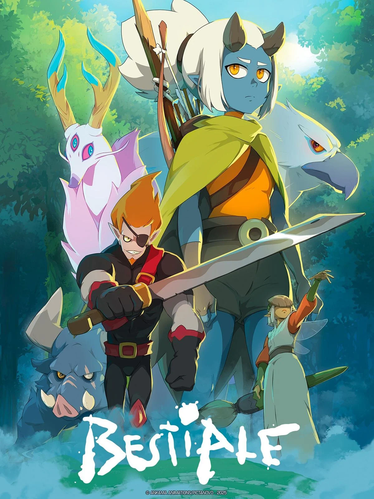

# Analyse du domaine — Joseph Karib

## Découverte de soi

- Mes forces : Je suis une personne créative et curieuse. J'aime la musique et l'animation, et j'aime découvrir de nouvelles façons de m'exprimer.
    - Exemple : Quand j'écoute de la musique, j'imagine des scénarios ou des ambiances qui pourraient correspondre au son.
- Mes faiblesses ou points à améliorer : Je dois améliorer ma gestion du temps et ma capacité à commencer un projet sans trop réfléchir.
    - Exemple :  Des fois, j'ai des idées qui m'intéresse, mais je prends du temps avant de commencer à les réaliser.
- Seul(e) ou en équipe : Seul
    - Pourquoi et exemple : Travailler seul me permet de développer mes idées à mon rythme, tandis que le travail d'équipe permet de combiner différentes compétences.
- Plutôt technique ou créatif : Créatif, surtout la musique, l'animation et la création d'univers visuels.

## Exploration des domaines

| Domaine | Intérêt | Pourquoi |
|---|---|---|
| Graphisme | +/- | J'aime les univers visuels et le style artistique des dessins animés. |
| Vidéo et animation 2D | + | J'aime les cartoons et je trouve intéressant de donner vie à des personnages. |
| 3D | +/- | Je suis curieux de découvrir comment les personnages et les environnements sont créés en trois dimensions. |
| Web | - | Je ne suis pas tant intéressé avec le web, je trouve c'est trop compliqué. |
| Jeux vidéo | +/- | J'aime l'idée de combiner des images, de l'animation et du son dans un même projet, mais je ne joue pas à des jeux vidéos. |
| Développement logiciel | - | Je suis plus attiré par la création artistique que par la programmation. |
| Installations et expériences immersives | +/- | J'aime l'idée de créer des expériences qui combinent le son, les images et l'interactivité. |

## Mes 2 domaines préférés

### Domaine 1 : Vidéo et animation 2D

J'aime regarder des séries animées et découvrir différents styles d'animation. J'aimerais apprendre à créer mes propres animations et personnages pour éventuellement travailler sur des séries télévisées comme South Park ou Family Guy. Je pourrais utiliser des logiciels comme Toon Boom Harmony, Adobe Animate et After Effects pour créer mes animations. J'aimerais aussi apprendre à utiliser différentes techniques pour donner vie à mes personnages. Mon intérêt pour ce domaine est très fort puisque j'aime les univers visuels, les dessins animés et la création d'histoires. J'aimerais pouvoir créer mes propres personnages et développer des univers imaginaires. J'aimerais vraiment travailler dans un studio d'animation qui produit des séries télévisées et participer à la création de dessins animés.

### Domaine 2 : Installation et experiences immersives

Je suis intéressé par les projets qui combinent la musique, les images et les effets visuels. J'aimerais découvrir comment créer des expériences visuelles qui attirent l'attention du public. Je pourrais utiliser des logiciels comme Blender, TouchDesigner et Resolume pour créer des effets visuels et des environnements immersifs. Mon intérêt pour ce domaine est moyen puisque j'aime mélanger différentes formes d'art et découvrir de nouvelles façons de présenter des images et du son. J'aimerais travailler dans un studio créatif qui réalise des installations artistiques, des spectacles visuels ou des expositions immersives.

## Les caractéristiques de mon domaine préféré

- Types d'entreprises : Dans le domaine de l'animation 2D, on retrouve principalement des studios de production audiovisuelle. Ces entreprises se spécialisent dans la création de films, de séries télévisées, de publicités et de contenus animés pour différentes plateformes. Certaines travaillent sur leurs propres projets tandis que d'autres réalisent des animations pour des clients.
- Exemple d'entreprise : Un exemple d'entreprise est Studio Unagi. C'est un studio montréalais spécialisé dans l'animation 2D pour la télévision, le cinéma et les jeux vidéo. Il participe à la création de séries animées et travaille sur différentes étapes de production, de la conception des personnages jusqu'au résultat final.

(source de l'image : https://studio-unagi.com/#work)

- Types de produits et de services : Les studios d'animation produisent différents contenus audiovisuels comme des séries télévisées, des films d'animation, des courts métrages et des publicités. Ils offrent aussi des services comme la création de personnages, la conception des décors, le storyboard, l'animation 2D et le montage final.
- Étapes de production : La première étape est l'idéation et la recherche, où il faut développer l'idée de la série, son histoire et son public cible. Ensuite, la préproduction qui consiste à écrire le scénario, créer les personnages et préparer le storyboard. Pendant la production, les animateurs donnent vie aux personnages et créent les décors et les scènes. La postproduction sert à ajouter les effets visuels, le son, la musique et à finaliser les épisodes. Finalement, le projet est diffusé à la télévision ou sur une plateforme en ligne
- Type d'emploi visé : J'aimerais devenir animateur 2D / créateur de son dans un studio de production à la télé avec des gens comme Seth Macfarlane ou Trey Parker. Mon travail consisterait à donner des idées d'épisodes, donner vie aux personnages, créer leurs mouvements et participer à la réalisation des scènes d'une série animée. J'aimerais aussi pouvoir contribuer à la création de personnages et d'univers originaux.
- Étapes pour obtenir cet emploi : Pour obtenir cet emploi, je devrais suivre une formation en animation 2D ou en création numérique afin d'apprendre les techniques et les logiciels nécessaires. Je devrais ensuite créer un portfolio avec mes dessins, mes personnages, ma musique et mes animations pour montrer mes compétences. Je pourrais aussi faire un stage dans un studio d'animation pour acquérir de l'expérience et éventuellement obtenir un emploi dans une entreprise du domaine.

## Conclusion

- Mon profil en une phrase : Je suis une personne créative qui aime travailler sur des projets visuels et qui souhaite développer ses compétences dans le domaine de l'animation 2D.
- Ce qui m'a surpris : J'ai été surpris par la quantité de travail et les différentes étapes nécessaires pour créer une série animée, de l'idée de départ jusqu'à la diffusion à la télévision.
- Ma force principale et la faiblesse à travailler : Ma principale force est ma créativité et ma capacité à trouver de nouvelles idées. Ma faiblesse à travailler est ma difficulté à gérer mon temps et à respecter les délais.
- Mon action d'ici la fin de la session : Je souhaite commencer à apprendre un logiciel d'animation 2D comme Toon Boom Harmony et réaliser une petite animation pour développer mon portfolio.

## Ma capsule

